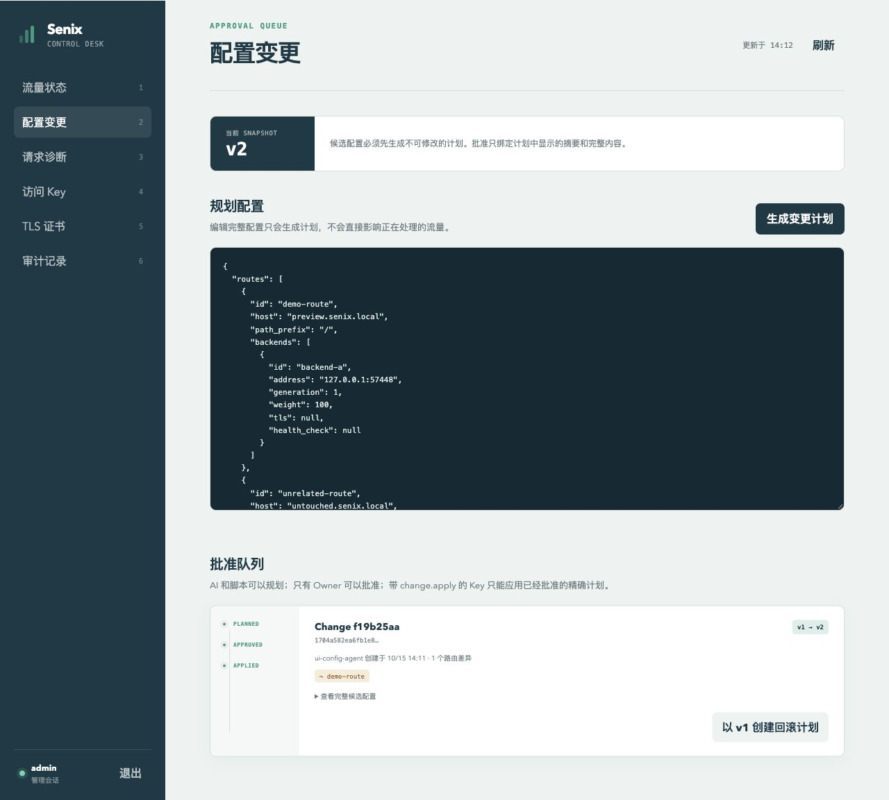
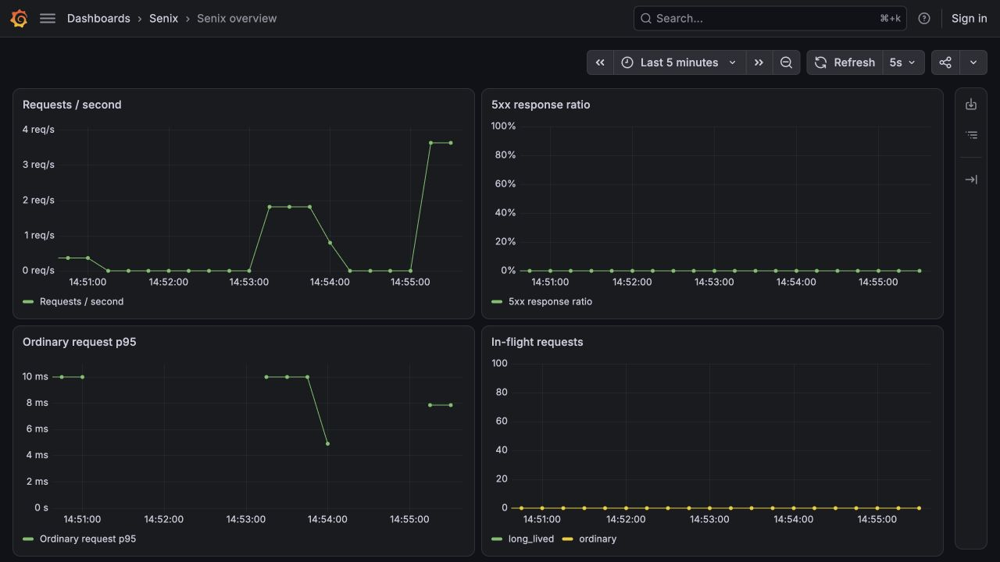
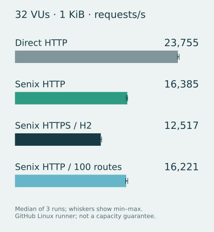

# Senix

[简体中文](./README.md) | **English**

**A Rust gateway with scoped AI tools and owner-approved configuration changes.**

Senix helps individual developers and small teams operate a gateway with an AI client. The AI reads live state and proposes a configuration; the human Owner reviews the exact plan before it can be applied. One `senixd` binary contains the Pingora proxy, SQLite control plane and admin console. It needs no external database. Your scripts handle application deployment.

> [!IMPORTANT]
> Senix is a working **v0.3 preview**. Validate your traffic, failure and recovery requirements before production use. The default installer and Docker demo use the published **v0.3.1**. New configuration-reading tools, planning version guards, configuration JSON Schema, Key presets, duration metrics and JSON logs are available in the current source and have not been released yet.

## Evidence you can inspect

| Question | Evidence |
| --- | --- |
| Can I start it? | The Docker demo starts two real backends, creates the Owner account and checks a real proxy request. [English onboarding checks](./docs/validation/2026-10-15-english-onboarding.md) cover clean starts, repeat starts, restart and saved configuration. |
| Can an AI change configuration safely? | A real MCP workflow read v1, planned a hostname change, waited for test Owner approval and applied v2. Requests checked the new hostname, old hostname and an unaffected route. [Initial validation](./docs/validation/2026-10-15-ai-configuration.md) and [version conflict/retry validation, Chinese](./docs/validation/2026-10-15-mcp-version-guard.md). |
| Can I monitor it? | Local Prometheus, Grafana, VictoriaMetrics, OTel Collector, Alloy and Loki paths were exercised. [Validation record, Chinese](./docs/validation/2026-10-15-observability.md) and [raw results](./docs/validation/2026-10-15-observability.json). |
| Is there a performance baseline? | 36 Linux AMD64 measurements completed 4,642,339 requests, including 3,066,768 through Senix, with zero HTTP failures. The ARM64 local baseline is also preserved. See [performance evidence](#performance-baselines). |
| What passed regression checks? | Rust 1.88: 81 tests, including 27 real-process E2E tests; formatting, strict Clippy, frontend build and npm audit. Rust dependency audit still reports [four upstream warnings, Chinese](./CONTRIBUTING.md). |

## Try the Docker demo

Install Git, Docker with Linux containers, Docker Compose v2 and curl. The demo needs access to the image registry, free ports `8080` and `9080`, and an available Docker subnet `172.28.0.0/24`.

```bash
git clone https://github.com/ALVIN-YANG/senix.git
cd senix
./scripts/demo.sh
```

The script prints the admin URL, Owner username, generated password and a real backend response. Open `http://127.0.0.1:9080/admin/` and sign in with those credentials. The admin UI is currently in Chinese; the [English AI guide](./docs/ai-configuration.en.md) includes the exact UI labels.

Check the proxy yourself; the `Host` header selects the demo route, so no DNS change is needed:

```bash
curl -f -H 'Host: demo.senix.local' http://127.0.0.1:8080/
```

If a port is occupied, set `SENIX_DEMO_PROXY_PORT=18080 SENIX_DEMO_ADMIN_PORT=19080` before `./scripts/demo.sh`, then use those ports in your browser, curl commands and MCP client. The proxy port accepts connections on all host interfaces; the admin port binds to loopback.

Stop the demo with:

```bash
docker compose --project-directory examples/demo -f examples/demo/compose.yml down
```

Stopping keeps the saved configuration and account. Run the script again and use the original password. Add `--volumes` to the stop command **only to delete the demo data and start over**. Keep any image and port overrides when restarting or stopping.

The default demo uses `ghcr.io/alvin-yang/senix:0.3.1`. To try the new AI workflow and observability features, build the current source:

```bash
docker build -t senix:local .
SENIX_IMAGE=senix:local SENIX_DEMO_PULL=0 ./scripts/demo.sh
```

Stop an older demo before starting the source image. The first build downloads and compiles dependencies; its duration depends on your machine and network. Existing databases restore their saved Snapshot and ignore the startup JSON.

[Complete the AI workflow: read → plan → Owner approval → apply → real requests](./docs/ai-configuration.en.md)

<details>
<summary>Binary installation and source build</summary>

```bash
curl --proto '=https' --tlsv1.2 -LsSf \
  https://raw.githubusercontent.com/ALVIN-YANG/senix/main/install.sh | sh
```

The installer supports Linux and macOS on x86_64 and ARM64, downloads a GitHub Release and checks its SHA-256. Linux requires glibc 2.34 or newer. You can [inspect the installer](./install.sh) first. `SENIX_RELEASE_BASE_URL` can point to a trusted HTTPS Release mirror; the mirror also supplies the checksum, so you must trust it.

A source build needs Rust 1.88, a C/C++ compiler and CMake:

```bash
cargo build --release --locked -p senixd
```

A manual binary deployment also needs reachable application backends, a configuration file, local credential bootstrap and Owner account bootstrap. The [Chinese deployment reference](./README.md) covers these steps, static TLS, upstream HTTPS and ACME. Use the Docker demo above for a complete first run.

</details>

## What it does

| Task | Implemented behavior |
| --- | --- |
| Proxy application traffic | Pingora HTTP proxy, exact and single-label wildcard hosts, longest path-prefix matching, smooth weighted round robin, active TCP/HTTP health checks |
| Work with rolling deployments | Persistent drain state, ordinary/long-lived in-flight counts, timeout status, rejoin with a newer deployment generation, weight changes and explicit disable |
| Review configuration changes | Immutable Change Plans, validation, structured route differences, content digest, 15-minute Owner approval, atomic Snapshot publication and rollback plans |
| Manage one gateway | Embedded Owner console, scoped API Keys, management audit, instance controls and structured request diagnostics |
| Let an AI help | Stateless Streamable HTTP MCP; tool catalog filtered by permissions and every call authorized again |
| Terminate and use TLS | Downstream static PEM or HTTP-01/SNI certificate activation; upstream HTTPS with system CA validation and H1/H2 ALPN |
| Observe behavior | Protected Prometheus metrics, traffic/health/in-flight state and certificate expiry; current source adds duration histograms, optional JSON access events and integration examples |
| Run and recover | Process health probe, non-root container, shutdown grace, consistent online SQLite backups, verification and restore to a new database |

The console and MCP use the same authorization and audit rules as REST. The control plane persists configuration in SQLite, then publishes an immutable runtime Snapshot. Business requests read the in-memory Snapshot and do not query SQLite.

## AI configuration changes

The [English walkthrough](./docs/ai-configuration.en.md) covers source startup, Key issuance, Cursor configuration, prompts, approval, verification and failures.

1. Call `get_current_config` and keep its `version` and complete `config`.
2. Change only the requested fields and call `plan_change` with the complete `candidate` and the read version as required `expected_version`. Its input Schema describes routes, backends, TLS and health checks.
3. If configuration changed after the read, `CONFIG_VERSION_MISMATCH` rejects the request before creating a plan. Read again and merge into the new configuration before retrying; do not just update the version number.
4. The Owner reviews and approves that exact plan in the console. Approval expires after 15 minutes.
5. Call `get_change`, then `apply_approved_change` for the same `change_id`. Read the new Snapshot and check changed and unaffected routes with real requests.

Existing MCP callers must add `expected_version`; REST v1 keeps its existing request format.

MCP cannot approve plans, issue Keys or run Shell, SSH, Docker or Kubernetes commands. A Key with `change.apply` can only apply a plan the Owner has already approved. Rollback creates another plan and follows the same approval path.

The endpoint is `http://127.0.0.1:9080/mcp`. Each request needs a Bearer API Key; browser Cookies are not accepted. Configuration reads and plans currently require global grants. The console's three Key presets are read-only diagnostics, proposal only and configuration collaboration; none grants approval or instance traffic operations. [llms.txt](./llms.txt) provides a compact index for agents.

The admin screenshot below comes from the real MCP workflow and shows Snapshot v2. The UI labels are Chinese.



## Traffic control for your scripts

Your deployment script can drain an instance, poll its operation, deploy the application, rejoin with a newer generation and then adjust weight based on application evidence. Senix does not run the deployment or decide when to increase traffic.

```bash
# Stop assigning new requests and obtain an operation_id.
curl -X POST \
  -H "Authorization: Bearer $SENIX_API_KEY" \
  -H 'Content-Type: application/json' \
  -H 'Idempotency-Key: deploy-42-drain-a' \
  -d '{"timeout_ms":60000,"force":false}' \
  http://127.0.0.1:9080/api/v1/instances/instance-a/drain

# Poll the operation_id returned by the drain request.
curl -H "Authorization: Bearer $SENIX_API_KEY" \
  http://127.0.0.1:9080/api/v1/operations/OPERATION_ID

# After deployment, rejoin with generation 2 and weight 5.
curl -X POST \
  -H "Authorization: Bearer $SENIX_API_KEY" \
  -H 'Content-Type: application/json' \
  -H 'Idempotency-Key: deploy-42-rejoin-a' \
  -d '{"generation":2,"weight":5,"force":false}' \
  http://127.0.0.1:9080/api/v1/instances/instance-a/rejoin
```

These commands assume an existing `instance-a`, its current generation is 1, another backend can serve traffic, and the Key has the required instance grants. Weight is relative to the other eligible backends; weight 5 does not by itself mean 5% of traffic.

All traffic writes require `Idempotency-Key`; retries with the same key return the original operation. Removing the last available backend and rejoining an unhealthy instance are rejected unless the operator explicitly uses `force`, which is audited as high risk. A drain timeout reports state; it does not kill or migrate connections.

On `SIGTERM`, Senix stops accepting new connections, allows 30 seconds for existing connections and then 5 seconds for runtime exit by default. Configure `--shutdown-grace-seconds` and `--shutdown-timeout-seconds` as needed. A single-process upgrade cannot transfer existing connections.

## Connect your monitoring stack

`/metrics` is on the admin listener and requires a Key with global `metrics.read`. Give the collector only that permission:

```bash
curl -H "Authorization: Bearer $SENIX_METRICS_KEY" \
  http://127.0.0.1:9080/metrics
```

Metrics cover request counts, response classes, proxy errors, Snapshot version, instance state, in-flight requests and certificate expiry. The current source adds request-lifetime histograms with separate ordinary and long-lived series. Optional JSON access events omit Host, URL, query, authorization, Cookies and request bodies.

| Stack | Integration | Verification level |
| --- | --- | --- |
| Prometheus + Grafana | Bearer scrape; 8 provisioned panels and 3 alert rules | Real scrape, PromQL and Grafana queries on a local Docker network |
| VictoriaMetrics, OTel Collector | Prometheus scrape / receiver | Real collection and re-export |
| Grafana Alloy + Loki | Metric remote_write and JSON file logs | Real forwarding and log queries |
| Mimir/Cortex, Thanos Receive, Grafana Cloud | Prometheus/Alloy remote_write | Example configuration; each service was not deployed |
| Datadog, Elastic/ELK, Zabbix | OpenMetrics/Prometheus and JSON log paths | Official configuration references; each service was not deployed |

[Runnable configurations](./examples/observability) · [Setup and credentials guide, Chinese](./docs/observability.md)



The examples load alert rules; notification delivery and sustained alert firing were not tested. There is no native trace/span export yet. OTel metrics collection does not establish full Tempo, Jaeger or APM support. Use your existing host/container agents for CPU and memory and an external probe for application availability. `senixd healthcheck` checks the management process, not backend or route health.

## Performance baselines

GitHub-hosted Linux AMD64 runner with 4 CPUs and 15.62 GiB RAM. Senix, k6 and the backend each have a 2-CPU / 1-GiB limit and share the runner. Fixed 1 KiB responses, Keep-Alive, 32 virtual users (VUs), 3-second warmup, three 10-second measurements. Values are medians; the RPS range shows the minimum and maximum.

| Path | RPS median (range) | p95 ms | Senix maximum end-of-run RSS sample |
| --- | ---: | ---: | ---: |
| Direct backend HTTP | 23,755 (23,698–23,947) | 3.40 | — |
| Senix HTTP | 16,385 (16,219–16,433) | 3.76 | 25.1 MiB |
| Senix HTTPS / H2 | 12,517 (12,273–12,640) | 3.93 | 35.1 MiB |
| Senix HTTP / 100 routes | 16,221 (16,133–16,449) | 3.83 | 24.6 MiB |



The [actual workflow](https://github.com/ALVIN-YANG/senix/actions/runs/38707502445) measured clean commit `af40d95`, before the MCP planning version guard. The four-case matrix at 1/32/128 VUs completed 4,642,339 requests, including 3,066,768 through Senix, with zero HTTP failures and all status/size checks passing. The HTTPS case observed 834,076 HTTP/2 responses. Latency includes sending, waiting and receiving, but excludes DNS/TCP/TLS connection setup. RSS is an end sample, not a per-run peak.

This shared runner provides a short baseline, not a production capacity or long-term stability guarantee. It does not establish superiority over other gateways. The [ARM64 local baseline](./docs/validation/2026-10-15-performance.md) remains available; differences between machines do not measure an optimization gain. Access logging and external collectors were off. Large bodies, long streams, failure recovery and configuration changes under load were not measured.

To repeat the matrix, install Python 3, Docker with Linux containers and cgroup v2, openssl, and allow about 4 GiB of free memory. Stop other load first:

```bash
docker build -t senix:observability .
docker pull grafana/k6:2.3.0
docker pull node:24-bookworm-slim
python3 benchmarks/run.py --image senix:observability --output target/benchmarks-local
```

Use a new output directory each time. The harness records raw k6 summaries and logs, cgroup/procfs resources, image identities, source hashes and machine conditions. Each run uses randomly named test containers on a Docker bridge with no host ports and cleans them up on exit.

[Linux method and results, Chinese](./docs/validation/2026-10-15-linux-performance.md) · [Raw Linux runs](./docs/validation/benchmarks/2026-10-15-linux/runs.json) · [Checksums](./docs/validation/benchmarks/2026-10-15-linux/SHA256SUMS) · [Harness details, Chinese](./benchmarks/README.md)

## Security, backup and limits

The Owner uses an Argon2id password and a short-lived signed browser Cookie with same-origin CSRF checks. API Keys are shown once; the server stores a digest, grants, expiry and revocation state. Audit events record actor, action, resource, outcome and risk without credentials or request bodies. Keep the management listener on loopback or a trusted private network. It has no built-in TLS; never expose `9080` directly to the Internet. Use a trusted TLS entry point and `--admin-secure-cookie` for remote browser access. Custom MCP Hosts and Origins must be explicitly allowed.

ACME account credentials and private keys are encrypted in SQLite with XChaCha20-Poly1305 and an external master-key file. Back up that file separately. `senixd backup create` uses SQLite's online consistent backup API; `verify` checks integrity, schema and encrypted materials; `restore` creates a new database and never overwrites the current one. Commands require the master key when encrypted materials exist. See the [Chinese backup procedure](./README.md#备份与恢复) before restoring a deployment.

- Single-node SQLite control plane; no distributed consensus or gateway fleet management.
- Keys support global or explicit Instance grants; there is no Service scope yet.
- ACME supports explicit HTTP-01 issuance and renewal. No DNS-01, automatic renewal scheduler or managed-certificate upload.
- No passive health signals, MCP stdio bridge, plugin adapters or system-service installer yet.
- No HTTP/3/QUIC, generic TCP/UDP proxy, mTLS or gRPC-Web conversion. WebSocket, SSE and gRPC streams are tracked separately; existing connections cannot be migrated.
- No built-in model, LLM API router or prompt management. Multi-model task evaluations and native tracing remain [future work, Chinese](./docs/ai-native-assessment.md).
- The current Pingora dependency tree still reports upstream warnings for `daemonize`, `derivative`, `unsafe-libyaml` and `lru 0.16.4` (`RUSTSEC-2026-0253`, panic-safety memory risk). A successful audit exit does not mean these risks are resolved.

## Contribute

Rust 1.88 is the project baseline. Rebuild embedded assets after changing `web/`, then run:

```bash
cd web
npm ci --ignore-scripts
npm run build
cd ..
cargo fmt --all -- --check
cargo clippy --workspace --all-targets --locked -- -D warnings
cargo test --workspace --locked
```

Dependency changes also require `cargo audit --deny yanked` and `npm audit --registry=https://registry.npmjs.org --audit-level=moderate` from `web/`. The real-process tests cover HTTP/TLS proxying, traffic control, health checks, authentication, audit, MCP, approved changes and encrypted certificate recovery. Read the [contribution guide, Chinese](./CONTRIBUTING.md), [security policy](./SECURITY.md) and [changelog, Chinese](./CHANGELOG.md).

To check the actual Docker demo, install Python 3, Docker Compose v2 and curl, with free ports 18080/19080 and an available `172.28.0.0/24` subnet:

```bash
docker compose --file examples/demo/compose.yml pull
python3 scripts/check-demo.py --runs 3
```

The check uses the published Compose image by default. Each run creates an isolated project and empty data, checks real proxy responses and Owner login, repeats startup, approves and applies a hostname change, then checks the exact saved configuration and account after restart. It removes only its own containers, network and volume. Results and sanitized command logs remain in a new `target/demo-check-*` directory; failures return a nonzero exit status.

Images must already be cached. To check source, build it first and pass `--image senix:local`. Override occupied ports with `--proxy-port` and `--admin-port`. This check uses test Owner REST APIs; it does not establish AI-client behavior, first-download reliability or long-term stability.

Add `--startup-failure` to occupy the proxy port first. The check requires startup to fail within 75 seconds while preserving the generated Owner password, then releases the port and verifies recovery and the full flow. CI runs this recovery check and uploads sanitized evidence after failure. Demo probes now limit each request to 2 seconds, and the first password is printed immediately after Owner creation so it remains available if startup fails.

[Failure reproduction, acceptance and sanitized evidence](./docs/validation/2026-10-15-demo-recovery.md)

[Apache License 2.0](./LICENSE)
