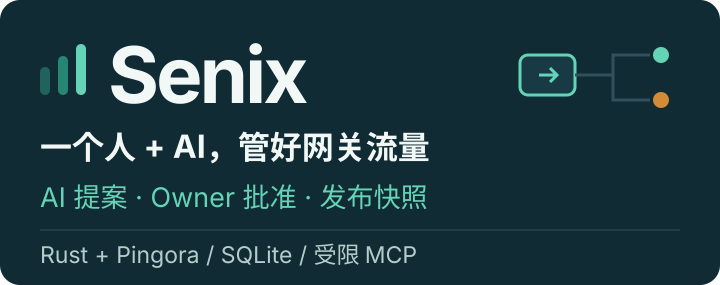
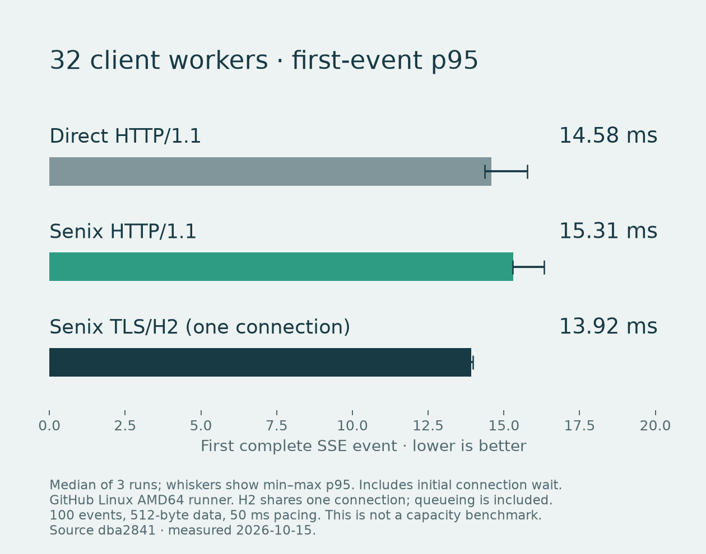
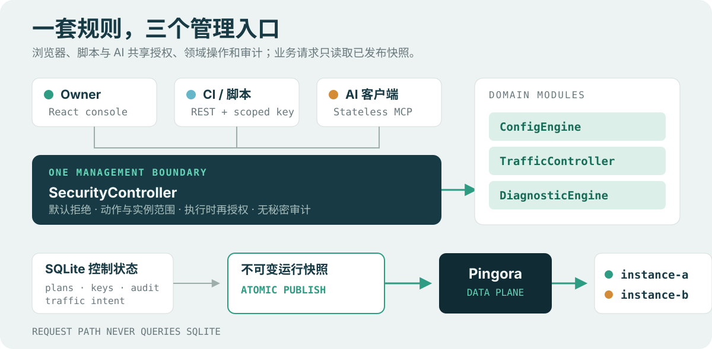
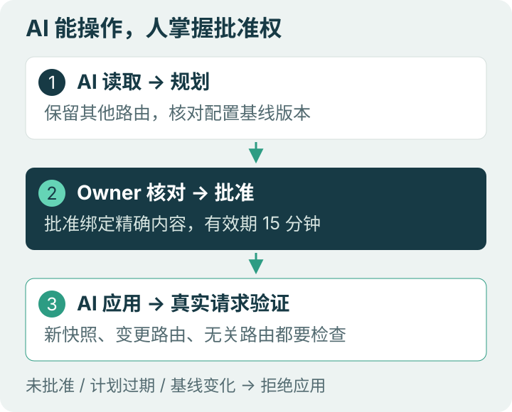

**简体中文** | [English](./README.en.md)

<p align="center">
  
</p>

<p align="center">
  
  
  <a href="https://github.com/ALVIN-YANG/senix/releases"></a>
  
</p>

Senix 是面向个人开发者和小团队的 Rust 网关。AI 通过受限 MCP 读取状态、提出配置计划，Owner 核对后批准，AI 再应用并验证结果。一个二进制包含 Pingora 代理、SQLite 控制面和管理后台，不依赖 Nginx 或外部数据库；实际部署由用户或外部脚本执行。

> [!IMPORTANT]
> 当前版本为 [`v0.4.1`](https://github.com/ALVIN-YANG/senix/releases/tag/v0.4.1)，处于 `0.x` 阶段。生产使用前请按自己的流量、故障模型和恢复要求完成验收；已实现能力与暂不支持范围都列在下方。

## 可核对的证据

| 项目 | 运行证据 |
| --- | --- |
| 发布 | `v0.4.1` 四份公开归档、双架构镜像和默认安装器已实际运行；完整 MCP 配置、重启与监控通过，原生及模拟环境逐项列明。见 [已发布产物验收](./docs/validation/2026-10-16-release-v0.4.1.md)。 |
| 上手 | Demo 自动引导、启动两个后端并发起真实代理请求；首次运行、重跑、重启与数据保留已验证。见 [快速开始](#快速开始)。 |
| AI | 当前 AI 助手实际通过 MCP 读取、规划、等待测试 Owner 批准、应用并验证新旧域名及无关路由。见 [首次验收](./docs/validation/2026-10-15-ai-configuration.md)；新增 [版本冲突与重试验收](./docs/validation/2026-10-15-mcp-version-guard.md)。 |
| 监控 | Prometheus、Grafana、VictoriaMetrics、OTel Collector、Alloy、Loki 的本机真实链路通过。见 [采集结果与截图](./docs/validation/2026-10-15-observability.md)。 |
| 长响应与实时连接 | 当前源码通过真实 SSE 分段转发、WebSocket 双向收发与关闭、TLS/HTTP2 上的 gRPC 双向消息和成功/错误 trailers；摘流后新请求转到备用后端，已有流继续完成。见 [SSE / WebSocket](./docs/validation/2026-10-15-streaming.md) 与 [gRPC 协议验收](./docs/validation/2026-10-15-grpc.md)。 |
| 性能 | Linux AMD64 runner 的 36 次短请求测量完成 464.23 万请求，其中 306.68 万次经过 Senix，失败率为 0；另有 [27 次 SSE 长响应测量与原始事件样本](./docs/validation/2026-10-15-sse-performance.md)。见 [性能基线](#性能基线)。 |
| 回归 | 当前源码在 Rust 1.88 下 86 项测试通过，含 32 项真实进程 E2E；格式、严格 Clippy 和前端审计通过。依赖审计仍有 [4 条上游提示](./CONTRIBUTING.md)。 |

`v0.4.0` 包含以上 AI 配置与监控能力。旧 MCP 调用方须补 `expected_version`；详见 [升级说明](./docs/releases/v0.4.0.md)。性能结果保留其原始提交和测量环境，不代表此版本的生产容量。

## 快速开始

有 Docker 时，直接启动一个 Senix 和两个演示后端：

```bash
git clone --branch v0.4.1 --depth 1 https://github.com/ALVIN-YANG/senix.git
cd senix
SENIX_IMAGE=ghcr.io/alvin-yang/senix:0.4.1 ./scripts/demo.sh
```

脚本会生成 Owner 密码，并输出管理后台地址和一次真实代理结果。Owner 创建未完成时，修正错误后重跑会继续创建账号；已创建的账号保留原密码。停止演示不会删除数据；执行输出中的重置命令才会清空演示卷。

以上命令直接使用 `0.4.1` 镜像，无需编译。按 [AI 配置变更指南](./docs/ai-configuration.md) 完成“读取 → 规划 → Owner 批准 → 应用 → 真实请求验证”。

`v0.4.1` 包含中英文管理后台，登录页和页头可切换语言并记住选择。见 [本次发布说明](./docs/releases/v0.4.1.md) 与 [真实流程及窄屏验收](./docs/validation/2026-10-15-admin-languages.md)。

端口冲突时可覆盖 `SENIX_DEMO_PROXY_PORT` 和 `SENIX_DEMO_ADMIN_PORT`，例如 `SENIX_DEMO_PROXY_PORT=18080 SENIX_DEMO_ADMIN_PORT=19080 ./scripts/demo.sh`。

只安装二进制时：

```bash
curl --proto '=https' --tlsv1.2 -LsSf \
  https://raw.githubusercontent.com/ALVIN-YANG/senix/main/install.sh | sh
```

安装器支持 Linux 和 macOS 的 x86_64、ARM64，下载 GitHub Release、校验 SHA-256，并在覆盖前试运行新程序；新程序无法运行时保留原安装。`v0.4.0` Linux 包要求 glibc 2.34 或更新版本，两种架构均在 glibc 2.34 上执行检查。旧 `v0.3.1` Linux 包实际要求 glibc 2.38，旧包未替换；见 [兼容性验收](./docs/validation/2026-10-15-portable-release.md)。也可以先下载并检查 [`install.sh`](./install.sh) 再执行。

下载遇到临时断连会自动重试。无法直连 GitHub 时，可将 `SENIX_RELEASE_BASE_URL` 设置为自己信任的 HTTPS Release 镜像根地址；归档仍会按镜像中同版本的 `checksums.txt` 校验，因此镜像本身必须可信。

<details>
<summary><strong>从源码构建</strong></summary>

需要 Rust `1.88`、C/C++ 编译器和 CMake。示例配置假定本机已有两个 HTTP 后端，分别监听 `4101` 和 `4102`。

```bash
# macOS
brew install cmake

# Ubuntu / Debian
sudo apt-get install build-essential cmake

cargo build --release --locked -p senixd
```

第一次运行前，在服务器本机完成两步引导。

```bash
# 1. 建立一次性 Owner 引导凭据
cargo run -p senixd -- credential bootstrap \
  --db /tmp/senix.db \
  --label local-owner

# 2. 从标准输入创建唯一 Owner 账号
printf '%s' "$SENIX_OWNER_PASSWORD" | cargo run -p senixd -- owner bootstrap \
  --db /tmp/senix.db \
  --username admin \
  --password-stdin
```

账号创建成功后，一次性引导凭据会在同一个 SQLite 事务中失效。然后启动网关：

```bash
cargo run -p senixd -- \
  --listen 127.0.0.1:8080 \
  --admin-listen 127.0.0.1:9080 \
  --db /tmp/senix.db \
  --config examples/gateway.json
```

健康阈值通过后，验证代理和管理面：

```bash
curl -H 'Host: example.test' http://127.0.0.1:8080/
open http://127.0.0.1:9080/admin/
```

数据库为空时必须提供 `--config`。已有 Snapshot 时，Senix 从 SQLite 恢复最新版本并忽略启动配置，避免重启覆盖已经生效的状态。

已有 PEM 证书时，可以让同一个数据面同时监听 HTTP 和 HTTPS：

```bash
senixd \
  --listen 0.0.0.0:80 \
  --tls-listen 0.0.0.0:443 \
  --tls-cert /etc/senix/tls/fullchain.pem \
  --tls-key /etc/senix/tls/privkey.pem \
  --admin-listen 127.0.0.1:9080 \
  --db /var/lib/senix/senix.db \
  --config /etc/senix/gateway.json
```

`--tls-cert` 与 `--tls-key` 必须一起提供。证书会在启动时完整校验，并作为默认 SNI 证书加载。

后端本身使用 HTTPS 时，在对应实例上显式声明 TLS。证书校验默认开启，`server_name` 同时用于 SNI 和主机名校验：

```json
{
  "id": "instance-a",
  "address": "10.0.0.21:443",
  "generation": 1,
  "weight": 100,
  "tls": {
    "server_name": "api.internal.example.com",
    "alpn": "http2_or_http1"
  }
}
```

`alpn` 可选 `http1`、`http2` 或 `http2_or_http1`，默认为 `http1`。HTTP 主动检查会使用相同的 TLS 校验与协商设置。只有自签名开发环境才应显式设置 `verify_certificate: false`；生产环境不要关闭证书校验。完整示例见 [`examples/upstream-tls.json`](./examples/upstream-tls.json)。

使用 ACME HTTP-01 时，先生成独立于数据库的主密钥文件：

```bash
sudo install -d -m 700 /etc/senix
senixd secret-key generate --output /etc/senix/secret.key

senixd \
  --listen 0.0.0.0:80 \
  --tls-listen 0.0.0.0:443 \
  --secret-key-file /etc/senix/secret.key \
  --acme-directory-url https://acme-v02.api.letsencrypt.org/directory \
  --acme-contact mailto:ops@example.com \
  --acme-accept-terms \
  --admin-listen 127.0.0.1:9080 \
  --db /var/lib/senix/senix.db \
  --config /etc/senix/gateway.json
```

域名解析到这个 HTTP 入口后，可在管理后台手动签发，也可由脚本调用：

```bash
curl -X POST \
  -H "Authorization: Bearer $SENIX_API_KEY" \
  -H 'Content-Type: application/json' \
  -d '{"domains":["api.example.com"],"timeout_seconds":90}' \
  http://127.0.0.1:9080/api/v1/certificates/issue
```

API Key 需要全局 `certificate.issue` 权限。ACME 账户和证书私钥使用主密钥加密后写入 SQLite；签发成功会原子切换 SNI 证书，不重启网关。当前不会自行安排续期，仍由用户或脚本触发。

</details>

<details>
<summary><strong>使用 Docker 构建和运行</strong></summary>

```bash
docker build -t senix:dev .

docker run --rm \
  -v senix-data:/var/lib/senix \
  senix:dev credential bootstrap \
  --db /var/lib/senix/senix.db \
  --label local-owner

printf '%s' "$SENIX_OWNER_PASSWORD" | docker run --rm -i \
  -v senix-data:/var/lib/senix \
  senix:dev owner bootstrap \
  --db /var/lib/senix/senix.db \
  --username admin \
  --password-stdin

docker run --rm \
  -p 8080:8080 \
  -p 127.0.0.1:9080:9080 \
  -v "$PWD/gateway.json:/etc/senix/gateway.json:ro" \
  -v senix-data:/var/lib/senix \
  senix:dev
```

容器以非 root 用户运行。`gateway.json` 中的后端地址必须能从容器网络访问，不能照搬宿主机的 `127.0.0.1`。

</details>

## 性能基线

GitHub 托管 Linux AMD64 runner（4 CPU / 15.62 GiB），Senix、k6、后端各限制 2 CPU / 1 GiB，共享 runner 资源。固定 1 KiB 响应、Keep-Alive，以下选用 32 VU；预热 3 秒，每次测量 10 秒，重复 3 次。数字为三次中位数，RPS 括号为最小–最大值。

| 路径 | RPS 中位数（范围） | p95 ms | Senix RSS 最大结束样本 |
| --- | ---: | ---: | ---: |
| 直连后端 HTTP | 23,755 (23,698–23,947) | 3.40 | — |
| Senix HTTP | 16,385 (16,219–16,433) | 3.76 | 25.1 MiB |
| Senix HTTPS / H2 | 12,517 (12,273–12,640) | 3.93 | 35.1 MiB |
| Senix HTTP / 100 路由 | 16,221 (16,133–16,449) | 3.83 | 24.6 MiB |


[实际工作流](https://github.com/ALVIN-YANG/senix/actions/runs/38707502445) 固定在 `af40d95`，早于 MCP 版本校验增量。完整矩阵为四场景 × 1/32/128 VU × 三次，共完成 4,642,339 次请求，其中 3,066,768 次经过 Senix，HTTP 失败率均为 0；HTTPS 的 834,076 次响应均为 HTTP/2。延迟不含 DNS/TCP/TLS 建连；RSS 来自 `/proc/1/status` 的结束采样，不是单次峰值。

这是共享 runner 的短时基线，尚不能证明生产容量、长期稳定性或比其他网关更快。[ARM64 本机基线](./docs/validation/2026-10-15-performance.md) 也完整保留；不同机器间的数值差异不能解释为优化收益。

[Linux 完整结果、环境与原始数据 →](./docs/validation/2026-10-15-linux-performance.md) · [运行相同基准](./benchmarks/README.md)

### SSE 长响应

独立的 [Linux SSE 基线](./docs/validation/2026-10-15-sse-performance.md) 固定在干净提交 `dba2841`：27 次测量完成 6,498 条完整流、649,800 条事件，其中 4,263 条流经过 Senix，流失败为 0。每条流发送 100 条预先构造的事件，每条 JSON 数据 512 字节，按 50 ms 定时器调度；这是定速合成输出。



32 VU 下，首个完整事件 p95 的三次中位数为 Senix HTTP/1.1 **15.312 ms**、TLS/HTTP2 **13.920 ms**，包含初始连接等待和客户端解析。所有代理场景的 RSS 最大结束样本为 **42.63 MiB**。

完整矩阵也保留了排队结果：128 VU 共用一条 HTTP/2 连接时，服务端通告上限为 100 个并发流，后端峰值为 100，首事件 p95 为 **5,000.579 ms**。这不是相同活动流数下的协议成本对比。原始微秒样本、环境、连接策略和重算结果均可核对；该基线不测真实模型推理，也不证明最大容量或长期稳定性。

## 已经能做什么

| 场景 | 当前实现 |
| --- | --- |
| 代理流量 | Pingora HTTP 代理、精确/单标签通配域名、最长路径匹配、平滑加权轮询、HTTP/TCP 主动健康检查 |
| 滚动部署配合 | 持久化摘流、在途请求查询、超时状态、新代次回接、权重调整、明确禁用 |
| 安全改配置 | 不可修改的 Change Plan、结构化差异、15 分钟 Owner 批准、原子 Snapshot 发布、回滚计划 |
| 一个人管理 | Owner 控制台、受限 API Key、操作审计、实例维护控制舱、请求证据链 |
| AI 协作 | 无会话 Streamable HTTP MCP；工具按 Key 权限裁剪，调用时再次授权 |
| TLS 证书 | 下游静态 PEM/HTTP-01/SNI 热切换；上游 HTTPS、系统 CA 验证与 H1/H2 ALPN |
| 可观测性 | 受保护的 Prometheus 指标、实例在途/长连接、结构化诊断和无秘密审计；源码新增耗时直方图、可选 JSON 日志和监控示例 |
| 运行与恢复 | 进程探针、非 root 容器、退出宽限时间、SQLite 在线一致性备份、校验和不覆盖现场的恢复 |

## 怎么工作

Owner 控制台、REST 脚本和 MCP 客户端共享同一权限与审计边界。控制面把配置写入 SQLite，再发布不可变运行快照；Pingora 处理业务请求时只读取内存快照，不查询 SQLite。

<details>
<summary><strong>展开完整架构图（适合桌面查看）</strong></summary>

<p align="center">
  
</p>

</details>

核心逻辑按领域拆成独立 Module：

- `ConfigEngine` 负责预检、差异、批准、发布与回滚计划。
- `TrafficController` 负责摘流、回接、权重、禁用、幂等和持久化。
- `GatewayRuntime` 负责不可变 Snapshot、请求选路和在途计数。
- `DiagnosticEngine` 从同一运行快照产生结构化证据，不从日志猜状态。
- `CertificateController` 加密保存账户凭据和证书私钥，Pingora 只读取已发布的证书快照。

更完整的产品边界见 [需求文档](./docs/requirements.md)，关键设计决定见 [ADR](./docs/adr)。

## 管理后台

后台静态资源嵌入 `senixd`，不需要部署第二个 Web 服务。Owner 登录后可以：

- 查看实例的流量状态、健康状态、权重和部署代次；
- 手动摘流、回接、调整权重或二次确认禁用实例；
- 编辑完整候选配置，核对差异和摘要后批准精确计划；
- 模拟 Host 与路径的选路结果，复制原始诊断 JSON；
- 创建最小权限 Key、吊销 Key，并查看无秘密审计记录。
- 查看证书有效期，手动发起 HTTP-01 签发并热切换。

`v0.4.0` 增加了“只读诊断”“配置提案”“配置协作”三种 Key 模板，签发前仍可核对和修改动作、范围与有效期。诊断和配置动作需要全局范围，模板会明确选中所有当前和未来实例；它们不提供实例隔离。

最后一个可用后端和不健康实例回接不会被静默绕过。只有操作者显式选择 `force` 才能继续，操作会被标记为高风险。

修改前端后需重新生成嵌入产物：

```bash
cd web
npm ci --ignore-scripts
npm run build
```

## 配合外部脚本滚动部署

Senix 提供原子流量操作，不维护整套发布计划：

```text
drain(instance, timeout, idempotency_key)
  → poll(operation_id)
  → 外部脚本执行部署
  → rejoin(instance, new_generation, weight)
  → 外部脚本观察并调整权重
```

```bash
# 摘流：立即停止新请求，并返回 operation_id
curl -X POST \
  -H "Authorization: Bearer $SENIX_API_KEY" \
  -H 'Content-Type: application/json' \
  -H 'Idempotency-Key: deploy-42-drain-a' \
  -d '{"timeout_ms":60000,"force":false}' \
  http://127.0.0.1:9080/api/v1/instances/instance-a/drain

# 查询返回的摘流操作
curl -H "Authorization: Bearer $SENIX_API_KEY" \
  http://127.0.0.1:9080/api/v1/operations/OPERATION_ID

# 部署结束后，以新代次和相对权重 5 回接
curl -X POST \
  -H "Authorization: Bearer $SENIX_API_KEY" \
  -H 'Content-Type: application/json' \
  -H 'Idempotency-Key: deploy-42-rejoin-a' \
  -d '{"generation":2,"weight":5,"force":false}' \
  http://127.0.0.1:9080/api/v1/instances/instance-a/rejoin
```

所有流量写操作都要求 `Idempotency-Key`。重复调用返回原操作结果，不会重新摘流当前代次。会让路由失去最后一个可用后端的摘流默认返回 `409 LAST_AVAILABLE_BACKEND`。

Senix 自身收到 `SIGTERM` 后会停止接收新连接，默认给已有连接 30 秒完成，再给运行时 5 秒退出。可通过 `--shutdown-grace-seconds` 和 `--shutdown-timeout-seconds` 调整；systemd 的 `TimeoutStopSec` 应大于两者之和。超过期限的长连接仍可能被中断，单机进程升级不能迁移已经建立的连接。

## 接入主流监控

`/metrics` 位于管理端口，匿名访问会被拒绝。为采集器创建一把只含全局 `metrics.read` 的 Key，然后配置 Bearer 认证：

```bash
curl -H "Authorization: Bearer $SENIX_METRICS_KEY" \
  http://127.0.0.1:9080/metrics
```

指标覆盖请求量、响应类别、代理错误、快照版本、实例状态、在途数和证书到期风险。`v0.4.0` 新增普通请求/长连接分开的耗时直方图，可计算 p50/p95/p99，并可显式开启脱敏 JSON 访问日志。标签不包含 Host、URL、Key 或请求体。

| 使用中的系统 | 接入通路 | 本轮证据 |
| --- | --- | --- |
| Prometheus + Grafana | Bearer 抓取，8 个预置面板、3 条告警规则 | 真实采集、PromQL、Grafana 查询通过 |
| VictoriaMetrics、OTel Collector | Prometheus scrape/receiver | 真实采集和重新导出通过 |
| Grafana Alloy + Loki | remote_write 指标、JSON 文件日志 | 真实发送和日志查询通过 |
| Mimir/Cortex、Thanos、Grafana Cloud | Prometheus/Alloy remote_write | 配置示例，未逐一部署 |
| Datadog、Elastic/ELK、Zabbix | OpenMetrics/Prometheus、JSON 日志 | 官方配置对照，未逐一部署 |

[启动本机监控或接入现有系统 →](./docs/observability.md) · [可运行配置](./examples/observability)


Senix 当前没有原生 trace/span 导出；不能把指标接入解释为已完整支持 Tempo、Jaeger 或其他 APM。宿主机 CPU/内存和业务可用性检测使用现有 Agent、node_exporter/cAdvisor、blackbox exporter。
容器镜像内置相同探针；非容器部署可执行 `senixd healthcheck --address 127.0.0.1:9080`。它只检查管理进程是否能响应，不代表后端实例或业务路由已经健康。

## 备份与恢复

备份可在 Senix 运行时在线创建。命令使用 SQLite 一致性 Backup API，完成完整性和 Schema 校验后以 `0600` 原子落盘，已存在的目标文件不会被覆盖：

```bash
senixd backup create \
  --db /var/lib/senix/senix.db \
  --output /var/backups/senix-$(date +%F).db \
  --secret-key-file /etc/senix/secret.key

senixd backup verify \
  --input /var/backups/senix-2026-08-14.db \
  --secret-key-file /etc/senix/secret.key
```

数据库包含 Key 摘要、审计、配置快照，以及加密后的 ACME 账户和证书私钥；主密钥文件不会被打进同一份备份，必须单独安全备份。数据库含加密材料时，创建、校验和恢复都会要求主密钥并实际解密全部材料。

恢复只创建新数据库，不覆盖现场文件。先停止目标实例，再恢复到新路径并用该路径启动；确认无误后再自行归档旧库：

```bash
senixd backup restore \
  --input /var/backups/senix-2026-08-14.db \
  --db /var/lib/senix/restored.db \
  --secret-key-file /etc/senix/secret.key
```

## 安全变更

配置不会从编辑器直接进入数据面：

1. 用户、脚本或 AI 创建不可修改的 Change Plan。
2. Senix 校验完整候选配置，生成差异和内容摘要。
3. 只有 Owner 可以批准这份精确内容，批准有效期为 15 分钟。
4. Owner 或带 `change.apply` 的 Key 应用已批准计划，发布新的不可变 Snapshot。
5. 回滚同样先生成计划，不绕过批准流程。

MCP 没有批准工具，也不能修改已生成计划。

<p align="center"></p>

[AI 配置变更指南](./docs/ai-configuration.md) 包含工具参数、权限模板、并发版本核对和失败处理；[llms.txt](./llms.txt) 为 AI 提供精简文档入口。项目提供 AI 可调用的运维工具，当前不包含内置模型、模型路由或提示词管理。


这次验收中，AI 读取 v1、提出域名变更，测试 Owner 批准后 AI 应用为 v2；新域名返回 200，原域名返回 404，无关路由仍返回原后端。见 [完整验收记录](./docs/validation/2026-10-15-ai-configuration.md)。

## MCP 与权限

Streamable HTTP MCP 位于 `http://127.0.0.1:9080/mcp`。每个请求都使用管理后台生成的 Bearer Key；MCP 不接受浏览器 Cookie，也不保存协议会话。

当前工具覆盖实例查询与流量控制、请求诊断、配置与回滚规划、应用已批准计划、证书查询与 HTTP-01 签发、审计读取。证书工具只返回元数据，不返回 ACME 账户凭据或证书私钥。

`v0.4.0` 新增 `get_current_config`，使用全局 `change.read` 权限返回当前 Snapshot 的 `version` 和完整 `config`。AI 可据此保留其他路由并创建候选配置；MCP `plan_change` 必须携带读取的 `expected_version`，版本变化会在创建计划前拒绝；候选字段由配置 JSON Schema 公开。旧 MCP 调用方需补版本参数，REST v1 保持兼容。完整接入和故障处理见 [AI 配置变更指南](./docs/ai-configuration.md)。旧 `v0.3.1` 包不包含这些新增能力。

工具清单会按 Key 的动作和实例范围裁剪，实际调用仍会再次授权。MCP 不提供 Key 创建、计划批准、Shell、SSH、Docker 或 Kubernetes 工具。

默认只接受 `localhost`、`127.0.0.1` 和 `::1` 的 Host。通过私网域名访问时需要显式配置：

```bash
senixd \
  --mcp-allowed-host gateway.internal \
  --mcp-allowed-origin https://admin.example.com \
  --listen 127.0.0.1:8080 \
  --admin-listen 0.0.0.0:9080 \
  --db /var/lib/senix/senix.db \
  --config /etc/senix/gateway.json
```

## 安全边界

| 凭据 | 用途 | 保护 |
| --- | --- | --- |
| Owner Account | 浏览器管理后台 | Argon2id 密码、短期签名 Cookie、同源 CSRF 头 |
| API Key | REST 脚本与 MCP | 完整值只展示一次、服务端仅存摘要、动作与实例范围、有效期、撤销 |
| Secret Key File | ACME 账户与证书私钥 | 外部 `0600` 文件；SQLite 只保存 XChaCha20-Poly1305 密文 |

管理端口默认应只绑定本机或私网。当前未内置管理面 TLS，不要把 `9080` 直接暴露到公网；通过受信 TLS 入口访问时增加 `--admin-secure-cookie`。

Owner 登录按真实 TCP 来源限制失败次数，不信任 `X-Forwarded-For`。同一来源在 5 分钟内失败 5 次会锁定 15 分钟，密码校验最多并发 2 次，所有登录和错误响应都禁止缓存。

审计记录操作者、动作、资源、结果和风险，不保存密码、Cookie、API Key、Authorization 头或完整请求体。

## 当前限制

- ACME 当前只支持 HTTP-01；可由后台或脚本显式续期，并通过 Prometheus 暴露到期风险；DNS-01、内置自动续期和手动上传托管证书尚未实现。
- WebSocket、SSE 和 gRPC 会单独计入长连接在途数；摘流超时只报告状态，不会强杀连接或迁移已有连接。
- 当前是单节点 SQLite 控制面，没有多节点一致性或网关集群管理。
- Service 还不是可授权的真实领域实体，Key 只支持全局或明确的 Instance 范围。
- 被动健康信号、MCP stdio 桥、插件 Adapter 和系统服务安装尚未实现。
- HTTP/3 不在当前 Pingora 数据面能力内。

详细取舍见 [需求文档](./docs/requirements.md)。AI 下一步最需要补的是多客户端/模型任务评测和原生追踪；见 [AI 使用能力核查](./docs/ai-native-assessment.md)。这些内容仍是后续候选，没有当作现有功能宣传。

## 仓库结构

```text
crates/senix-core      配置、流量、运行时、安全和诊断 Module
crates/senix-acme      HTTP-01 ACME 协议 Adapter
crates/senix-pingora   Pingora 数据面 Adapter
crates/senix-mcp       MCP Streamable HTTP Adapter
crates/senixd          单进程入口、健康检查、REST 与嵌入后台
web                    React 管理后台源码
docs                   需求与架构决策
examples               可运行配置
```

## 验证

```bash
cargo fmt --all -- --check
cargo clippy --workspace --all-targets --locked -- -D warnings
cargo test --workspace --locked
docker build --check .
```

端到端测试使用真实 HTTP/TLS 后端和 `senixd` 子进程，覆盖代理、流量控制、健康检查、鉴权、审计、MCP、批准应用及加密证书跨进程恢复。

Docker Demo 的实际启动与数据保留可独立验收，需要 Python 3、Docker Compose v2、curl，以及可用的 18080/19080 端口和 `172.28.0.0/24` 子网：

```bash
docker compose --file examples/demo/compose.yml pull
python3 scripts/check-demo.py --runs 3
```

脚本默认检查 Compose 中的发布镜像，每次使用独立项目和空数据，依次验证首次代理、Owner 登录、运行中重跑、批准并应用域名变更、重启后精确配置与账号保留。它只清理自己创建的容器、网络和卷；结果和脱敏命令日志保存在新建的 `target/demo-check-*` 目录，失败返回非零状态。镜像必须已缓存；源码镜像先构建，再用 `--image senix:local` 指定。可通过 `--proxy-port`、`--admin-port` 避开端口冲突。

这套检查通过测试 Owner 的 REST API 操作，不代表已验收某个 AI 客户端；它也不覆盖首次镜像下载、长期稳定性或所有启动故障。

增加 `--startup-failure` 会先由测试占用代理端口，要求启动在 75 秒内失败且已输出生成的 Owner 密码，再释放端口并验证重试和后续完整流程。增加 `--bootstrap-failure` 会先用短密码触发 Owner 校验失败，再重试并验证账号、代理与数据保留；CI 组合运行这两种恢复检查，失败时上传脱敏证据。Demo 探针每次请求最多等待 2 秒，首次密码在 Owner 创建成功后立即输出，便于启动失败后保留账号并重试。

[故障复现、修复验收和脱敏原始记录](./docs/validation/2026-10-15-demo-recovery.md) · [Owner 引导失败后的恢复验收](./docs/validation/2026-10-15-demo-owner-recovery.md)

## 参与开发

提交前请阅读 [CONTRIBUTING.md](./CONTRIBUTING.md)、[SECURITY.md](./SECURITY.md) 和 [CHANGELOG.md](./CHANGELOG.md)。

## License

[Apache License 2.0](./LICENSE)
