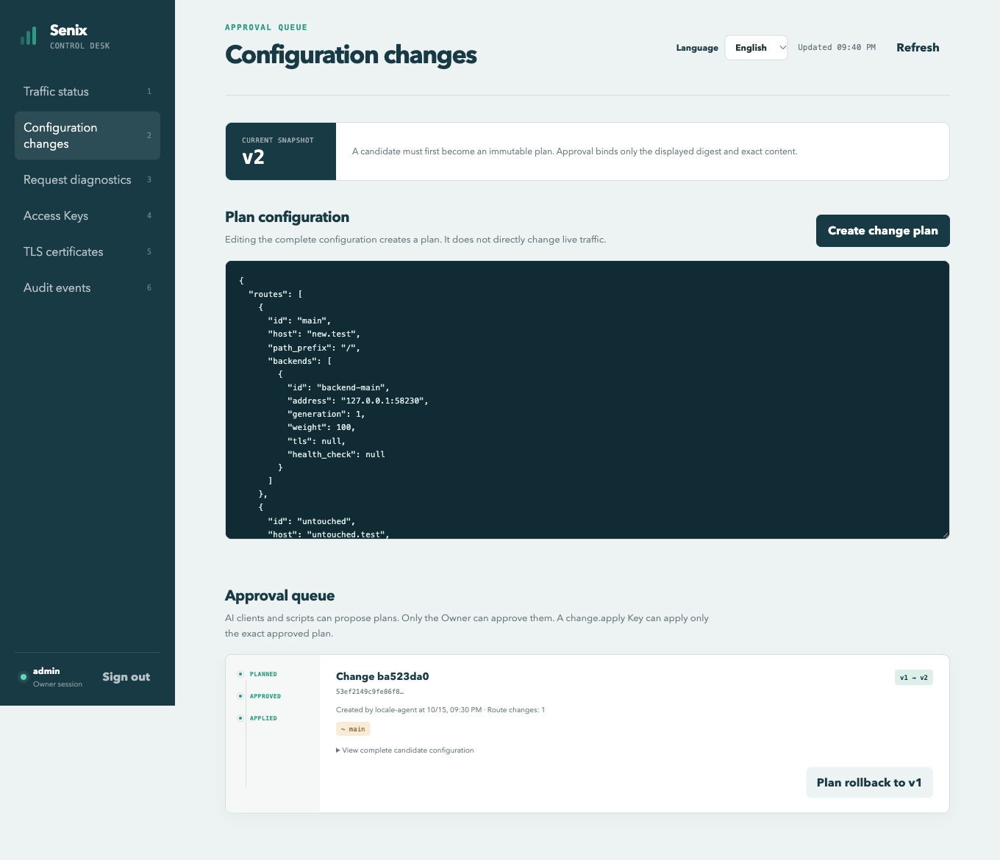

# 中英文管理后台验收

日期：2026-10-15。基线提交：`e0854fe3d433d8cff689ff20658a0d84492e7cdf`。本记录验证其后的中英文后台源码增量；该更新尚未进入已发布的 `v0.4.0` 安装包或镜像。

## 范围与实现

登录页、流量状态、配置变更、请求诊断、访问 Key、TLS 证书和审计页面支持简体中文与英文。登录页与页头都有语言选择器。首次按浏览器首选语言选择：中文使用简体中文，其他语言使用英文；手动选择保存在 `senix.language`。存储不可用时，当前页仍能切换。

界面使用集中词表与 React Context，没有增加前端运行依赖。提示在显示时翻译，参数只插值一次；时间按所选语言格式化。用户名、路由和实例标识、动作与错误码、配置 JSON、服务端错误及诊断证据保留原值。语言选择只改变显示，不改变接口、权限或配置语义。

## 真实浏览器与 MCP 流程

本机 macOS 26.5.2 ARM64，使用独立 Playwright Chromium 会话和真实 `senixd` 进程。两个隔离 HTTP 后端返回不同内容，测试 Owner、Key 和数据库均属于该验收实例。MCP 由脚本发送真实协议请求，不将这项检查称为多模型任务成功率评测。

1. 英文浏览器首次显示英文登录页；在中英文之间切换后，用户名和密码输入保留，已显示的登录错误随语言更新。
2. 英文 Key 表单选择配置协作模板，切换语言后名称、24 小时有效期、5 个动作及全局范围保留；服务端检查签发结果与选择一致。
3. 使用界面签发的同一把 Key，经 MCP 读取 v1、按配置 Schema 和 `expected_version=1` 规划域名修改；未批准时应用被拒绝。
4. 测试 Owner 在英文后台展开并核对完整候选，确认修改域名且保留无关路由，再点击 **Approve this exact content**。
5. MCP 应用精确计划到 v2，重复应用返回原结果；真实请求验证 `new.test=200`、`untouched.test=200`、`old.test=404`，且两个有效域名分别返回对应后端。
6. 重启网关后，原 Owner、同一 Key、精确配置及代理结果保留；浏览器显示 v2 和 APPLIED 状态。

[MCP 与重启结果](admin-languages/2026-10-15/mcp-flow.json) · [浏览器断言](admin-languages/2026-10-15/browser-checks.json)。

## 表单、偏好与布局

- 无效配置草稿在切换语言后逐字保留，JSON 错误提示即时更新。语言切换不发起后台请求；实现阶段发现的额外读取已消除。
- 实例维护表单的权重草稿与等待时间保留；摘除最后一个可用后端仍被拒绝，同一个错误在两种语言下显示正确路由标识，未授予 force。
- 证书空域名校验、ACME 未配置拒绝、域名输入保留与诊断 READY 说明在两种语言下正确显示。
- 手动选中文后刷新，仍保持中文，即使浏览器偏好为英文。独立上下文验证中文自动选择、无效偏好回退和禁用 localStorage 时的切换。
- 两种语言 × 6 个页面 × 5 种宽度（1360、900、620、360、320）共 60 个检查，没有页面横向溢出。中等宽度的图标导航保留完整本地化名称；英文长导航文字可换行。另检查 320px 下展开的维护、Key 和证书表单。

[60 个布局结果](admin-languages/2026-10-15/responsive.json) · [真实 360px 截图](admin-languages/2026-10-15/english-changes-mobile.png)。

## 检查与边界

Rust 1.88 下 82 项测试通过，含 28 项真实进程 E2E；格式与严格 Clippy 通过。新增 3 项前端测试覆盖语言选择、提示参数与原始数据保留、词表覆盖和占位符一致性，并纳入 CI。前端重新安装依赖和构建成功，npm 审计为 0 漏洞。运行实例返回的 HTML、JS、CSS 与当前提交资源逐字节一致，摘要见 [检查记录](admin-languages/2026-10-15/checks.json)。

本轮没有向公网 ACME 服务签发证书，也未更改系统剪贴板；证书签发与剪贴板权限路径不作为本次真实验收结论。没有修改代理热路径或重跑性能基准，已有性能图仍以其记录的提交为准。已发布 `v0.4.0` 仍使用中文后台；新界面需从当前源码构建。

[脱敏日志与运行脚本](admin-languages/2026-10-15/logs-and-fixtures.zip) · [SHA-256](admin-languages/2026-10-15/SHA256SUMS)。归档中 `<REPO>` 和 `<PLAYWRIGHT_CLI_WRAPPER>` 是路径替换标记；重放时替换为自己的目录及 CLI 包装器，并使用新的隔离测试目录。归档不含测试密码、完整 Key、Cookie、数据库或证书主密钥。测试实例与独立浏览器会话已停止，私密状态已删除，见 [清理结果](admin-languages/2026-10-15/cleanup.json)。
