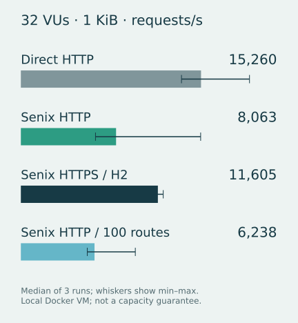

# 本机性能基线与原始证据

日期：2026-10-15。使用当前未发布源码的 release 镜像，工作区有改动，不能将结果归于已发布的 v0.3.1。没有做性能优化前后的对比，也没有对其他网关产品做排名。

## 方法与环境

- Apple M1 Pro，宿主机 16 GiB 内存；Docker Linux ARM64 VM，8 CPU、7.81 GiB 内存。共享开发机存在其他后台负载，没有隔离 CPU；短时结果有明显波动。
- Senix、Node 后端、k6 分别限制 2 CPU / 1 GiB；同一 Docker bridge 网络，无宿主机端口转发。Node 为单 worker，固定 1 KiB 响应，Keep-Alive。
- Senix 镜像：`sha256:55b61e0c0b43020214b38f922e525eeb4dabddc1ff2f21140ad53e704634f259`。k6 2.3.0、Node 24 系列的精确镜像 digest、源码与负载文件 SHA-256 见 [元数据](benchmarks/2026-10-15/metadata.json)。归档包含当时的负载器源文件。
- 四场景 × 1/32/128 VU × 三次独立测量，共 36 次；每场景/并发档预热 3 秒，每次测量 10 秒。固定顺序为直连、HTTP 代理、HTTPS 代理、100 路由 HTTP 代理，未随机交错，顺序与机器负载变化可能影响比较。
- 默认 Pingora 配置，没有新增 worker 调优。访问日志逐请求写入和外部监控采集关闭。新指标的常驻计数开销保留在网关内。
- 测量时间：2026-10-15T07:06:06Z 至 2026-10-15T07:15:44Z。本轮正式运行经 cgroup/procfs 采集资源，未并发构建 Rust/Docker 或运行监控栈。

## 完整结果

合计完成 3,099,779 次请求，其中经过 Senix 2,109,803 次；所有请求状态检查通过，HTTP 失败率均为 0。HTTPS 场景的 632,890 次请求均观测为 HTTP/2 响应。

| 场景 | VU | RPS 中位数（范围） | p50 ms | p95 ms | p99 ms | 失败率 |
| --- | ---: | ---: | ---: | ---: | ---: | ---: |
| Direct HTTP | 1 | 7,363 (5,381–7,984) | 0.035 | 0.199 | 0.762 | 0% |
| Direct HTTP | 32 | 15,260 (13,605–19,365) | 1.378 | 6.182 | 10.940 | 0% |
| Direct HTTP | 128 | 10,976 (6,401–12,627) | 7.304 | 34.521 | 66.465 | 0% |
| Senix HTTP | 1 | 697 (658–930) | 0.739 | 3.390 | 6.665 | 0% |
| Senix HTTP | 32 | 8,063 (6,322–15,227) | 2.065 | 9.948 | 25.927 | 0% |
| Senix HTTP | 128 | 16,586 (14,866–18,863) | 5.443 | 18.495 | 28.398 | 0% |
| Senix HTTPS / H2 | 1 | 2,376 (1,535–2,510) | 0.186 | 1.037 | 2.677 | 0% |
| Senix HTTPS / H2 | 32 | 11,605 (9,991–12,059) | 2.201 | 5.980 | 12.184 | 0% |
| Senix HTTPS / H2 | 128 | 7,615 (6,340–9,101) | 11.641 | 38.016 | 71.016 | 0% |
| Senix HTTP / 100 routes | 1 | 6,492 (2,499–7,037) | 0.075 | 0.219 | 0.609 | 0% |
| Senix HTTP / 100 routes | 32 | 6,238 (5,628–9,694) | 3.287 | 13.826 | 26.576 | 0% |
| Senix HTTP / 100 routes | 128 | 9,120 (7,592–10,980) | 10.784 | 33.408 | 53.497 | 0% |

RPS 和各分位数是三次运行各自指标的中位数，括号为 RPS 最小–最大值；不是把全部请求合并重算分位数。所有单次值均保留，不按结果筛选。

## CPU 与内存

| 场景（32 VU） | Senix CPU 窗口均值的中位数 | 结束时 RSS 最大样本 | 进程 HWM |
| --- | ---: | ---: | ---: |
| Senix HTTP | 38.6% | 16.5 MiB | 18.6 MiB |
| Senix HTTPS / H2 | 52.0% | 27.8 MiB | 27.9 MiB |
| Senix HTTP / 100 路由 | 36.0% | 21.7 MiB | 21.7 MiB |

CPU 以单核心 100% 计，由 cgroup `usage_usec` 增量除以窗口时长得到；窗口包含 k6 容器的启动/结束，因此不能当作精确负载阶段的 CPU 平均值。RSS 是 Senix 进程结束采样时刻的驻留内存；HWM 为整个 Senix 进程的历史峰值，包含预热和之前的并发档位，不是这三次运行单独的内存峰值。直连场景下 Senix 空闲，其数据只在原始文件中保留。

## 可以和不能得出的结论

这份数据证明了测试条件下 HTTP、HTTPS/H2 和 100 路由请求均能完成，并建立了可复测的延迟、吞吐与资源基线。共享开发机的重复波动仍大，直连基线也存在波动，因此不足以宣称“性能最强”、比其他网关更快或给出生产容量保证。

`http_req_duration` 包含发送、等待和接收，不包含 DNS/TCP/TLS 建连；TLS 连接复用，自签名验证仅在测试负载器中关闭。它没有覆盖大请求体、慢后端、长流、故障切换、流量中配置发布或长期稳定性。1/32/128 VU 是闭环客户端并发，不是目标 QPS 或最大连接能力。下一步应在独立 Linux 主机交错场景、延长持续时间并定位瓶颈，再提出性能优化结论。

## 数据与复现

- [运行与解释](../../benchmarks/README.md)、[汇总表](benchmarks/2026-10-15/table.md)、[逐次结果](benchmarks/2026-10-15/runs.json)、[资源汇总](benchmarks/2026-10-15/resource-summary.json)、[SHA-256 清单](benchmarks/2026-10-15/SHA256SUMS)。各场景子目录包含完整 k6 summary、日志和资源前后计数。
- 初次尝试中 `docker stats` 持续出现不可用的 `--` 样本，中止后改为 cgroup/procfs，重新跑完整矩阵。[初次排查数据](benchmarks/2026-10-15-docker-stats-attempt.zip) 保留，未用于 README 的性能数值；1 秒冒烟结果也未作为性能证据。
- 原始测量值不改写。公开元数据仅把本机绝对输出目录改成目录名。复测应使用记录中的镜像版本/digest，保留自己的机器条件和波动，不能把本机结果作为 CI 固定门槛。

## README 展示核对

本地 GitHub 风格预览在 900px 与 360px 浏览器视口检查，未发现页面横向溢出；6 个本地图片资源的引用和 SVG 基本检查通过。图表数值来自归档汇总，移动端可读。原架构图收进可展开区域，并在正文说明关键关系；真实截图保留原始页面内容。文档相对链接和 140 份基准文件的 SHA-256 校验通过。本记录生成时尚未发布到 GitHub、验证远端页面或触发工作流。
